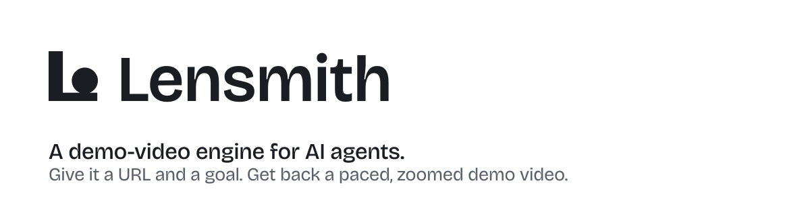
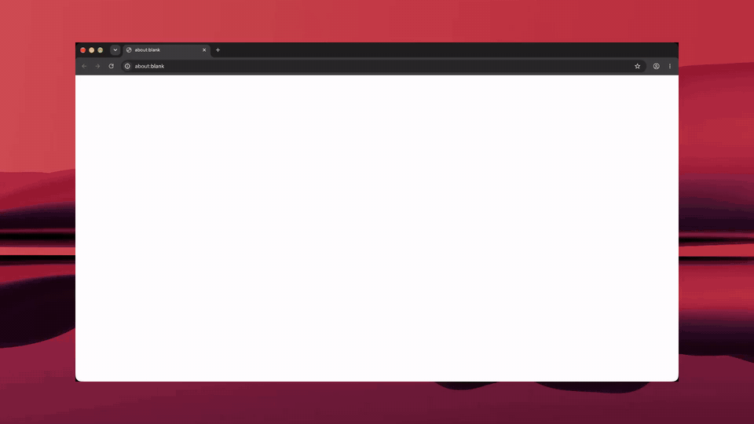
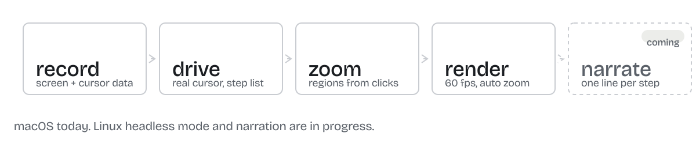

<!--
  Lensmith README (engine repo). Built from the ratified cards of CR-LENSMITH-A006-4.
  Assets live in .github/assets/ (copied from the round's assets/ folder, same file names).
  Repo settings to set by hand with this README: description "A demo-video engine for AI agents.",
  topics: screen-recording, demo-video, ai-agents, cli, macos, playwright; social preview:
  .github/assets/social-preview.png (1280x640).
  Only constructs GitHub Markdown renders are used: picture/source, p align, img width, tables,
  code blocks, details/summary. No custom CSS, no scripts.
-->

<p align="center">
  <picture>
    <source media="(prefers-color-scheme: dark)" srcset=".github/assets/banner-dark.svg">
    
  </picture>
</p>

<p align="center">
  <a href="https://github.com/ynetplus/lensmith/actions/workflows/ci.yml"></a>
  <a href="./LICENSE"></a>
  
  
  
</p>

**Lensmith records a screen, works out where the cursor was busy, zooms in on it and renders a paced 1080p60 demo clip.** It is a command-line tool built to be driven by AI agents and scripts, not by a person with a mouse. Pair it with [Lensmith Director](https://github.com/ynetplus/lensmith-director) and an agent can hand over a URL and a step list, and get back a finished demo of a real web app.

<p align="center">
  
</p>
<p align="center"><sub>Made by Lensmith from a URL and a list of goals. The film has a voice; this preview is the silent GIF of it.</sub></p>

## What an agent gets back

| Output | Made by | What it is |
|---|---|---|
| `final.mp4` | `process` | 1920x1080 at 60 fps, auto zoom on each region, the cursor drawn from telemetry, a wallpaper and a padded frame |
| `final.gif` | `gif` | the same render as a GIF |
| `captioned.mp4` + `.srt` | `caption` | word-level captions from WhisperX, burned in with ffmpeg |
| `hero`, `embed`, `social` variants + a poster frame | `package` | size-capped MP4s for a hero slot, a docs embed or a social post |

## Quickstart for agents

```bash
# 0. Is this machine ready? Read-only. Exit 0 = ready, 2 = not. --json lists the checks.
lensmith doctor --json

# 1. Record the screen with cursor telemetry (macOS). Stop with SIGINT (Ctrl+C).
#    Writes demo.mp4, demo.mp4.cursor.json and demo.session.json.
lensmith record --source screen --fps 60 --out demo.mp4

# 2. Where was the cursor busy? Zoom regions from the telemetry.
lensmith suggest-zooms --cursor demo.mp4.cursor.json --duration-ms 60000 --out zooms.json

# 3. A project file, then the render.
lensmith compose --zooms zooms.json --raw demo.mp4 --out demo.openscreen
lensmith process --project demo.openscreen --raw demo.mp4 \
  --cursor demo.mp4.cursor.json --out final.mp4

# 4. Optional: captions, a GIF, size-capped variants.
lensmith caption --in final.mp4 --out captioned.mp4 --srt-out captions.srt
lensmith gif --project demo.openscreen --raw demo.mp4 \
  --cursor demo.mp4.cursor.json --out final.gif
lensmith package --in final.mp4 --out-dir dist --profile embed
```

Every command reads and writes only the local files named on its command line. There is no daemon and no server. The one command that touches the network is `narrate`, see [Safety](#safety).

**To drive a real web app from a URL**, use [Lensmith Director](https://github.com/ynetplus/lensmith-director): the agent writes a step list (`url`, then `click`, `type` and `wait` steps) and runs `lensmith-director demo --steps steps.json --out-dir out`. The director moves the real macOS cursor, records through this engine and renders `out/final.mp4`.

## How it works

<p align="center">
  <picture>
    <source media="(prefers-color-scheme: dark)" srcset=".github/assets/pipeline-dark.svg">
    
  </picture>
</p>

1. **Record.** A native ScreenCaptureKit helper captures the display or one window at up to 60 fps, while a second helper logs the pointer position, clicks and cursor shape as telemetry (`.cursor.json`).
2. **Drive** (with Director). The real cursor moves along an eased path to each element and clicks it; every click lands in the action log and becomes a zoom region.
3. **Zoom.** Regions come from the clicks, or, for a human recording, from where the cursor dwelt (`suggest-zooms`).
4. **Render.** A headless Chromium hosts OpenScreen's PixiJS and WebCodecs exporter and writes the final MP4 or GIF. On macOS it renders on the GPU (Metal) by default and prints `lensmith: render GPU: <renderer>` when it does; set `LENSMITH_RENDER_GPU=0` to force software rendering.
5. **Narrate.** One narration line per step (`lensmith narrate`). Kokoro is the default voice: local and free, with its voice model downloaded once on first use. Edge TTS is optional. Word timings put each click on the word it belongs to, and `voiceover` mixes the voice into the film and burns the captions.

## Commands

| Command | Purpose |
|---|---|
| `lensmith record` | Record the screen with cursor telemetry (ScreenCaptureKit, macOS only). `--source screen` or `window:<id>`, `--fps`, `--mic`, `--system-audio`, `--out` |
| `lensmith suggest-zooms` | Suggest auto-zoom regions from cursor telemetry. `--cursor`, `--duration-ms`, `--default-duration-ms`, `--out` |
| `lensmith compose` | Compose a zooms fragment and a raw recording into a project file for `process`. `--zooms`, `--raw`, `--out`, `--aspect`, `--quality medium\|good\|source`, `--padding`, `--wallpaper`, `--border-radius`, `--shadow-intensity` |
| `lensmith process` | Render and export a project to a final MP4. `--project`, `--raw`, `--cursor`, `--cursor-shapes arrow\|native` (default `arrow`: the film always draws the arrow; `native` keeps the recorded hand and text cursors), `--out` |
| `lensmith gif` | Export a GIF from a project. Same flags as `process` |
| `lensmith caption` | Generate word-level captions via WhisperX and burn them in with ffmpeg. `--in`, `--out`, `--no-burn-in`, `--srt-out` |
| `lensmith narrate` | Synthesize narration lines to audio plus `timings.json` (word times, `[[mark]]` times, caption cues). `--script <json>`, `--out <dir>`, `--engine kokoro\|edge` (default `kokoro`, local; `edge` is online), `--voice <id>` (default `am_michael` for kokoro, `en-US-AndrewNeural` for edge), `--json`. Needs `uv` for the Python TTS helper |
| `lensmith voiceover` | Mix narration lines into a rendered film at given start times and burn captions from the script. `--video`, `--narration`, `--starts`, `--out`, `--captions burn\|srt\|none`, `--srt-out`, `--json` |
| `lensmith package` | Package a rendered MP4 into an embed-ready variant plus a poster frame. `--in`, `--out-dir`, `--profile hero\|embed\|social` |
| `lensmith doctor` | Check whether this machine is ready to record. Read-only, never prompts. `--json`. Exit 0 ready, 2 not |

`lensmith <command> --help` prints the live flag list; the table above is taken from it.

## Install

Requirements: macOS with the Xcode command line tools (`xcode-select --install`), Node.js 18 or newer, a Playwright Chromium for `process` and `gif`. `caption` also needs `ffmpeg` (built with libass) and WhisperX on `PATH`; `package` needs `ffmpeg`.

```bash
git clone https://github.com/ynetplus/lensmith.git
cd lensmith
npm install
npm run build
npm run build:native:mac      # compiles the ScreenCaptureKit and cursor helpers into bin/
npx playwright install chromium
npm link                      # optional: makes `lensmith` available on PATH
lensmith doctor
```

The first `record` asks macOS for Screen Recording permission (and Accessibility, for cursor shapes; without it the cursor shape is skipped and the recording still works).

## In progress

Planned and not shipped. None of it is in a release yet.

- **Headless mode on Linux**: capture over the Chrome DevTools Protocol, no macOS, no real cursor, for containers and CI.
- **Click ring**: a ripple on every click in the render.
- **HyperFrames-ready export**, an npm package, and a Claude skill with `AGENTS.md` for calling agents.

## Safety

Lensmith records whatever is on screen. Passwords and personal data visible during a recording end up in the video; review before sharing. It asks for the macOS permissions it needs, has no telemetry and no update check. Its network use is limited to `narrate`: with the default Kokoro engine, `uv` installs the Python packages and the voice model downloads once from Hugging Face on first use (the English language model, a spaCy wheel, comes from GitHub), and after that it runs offline; with `--engine edge`, each narration line's text is sent to Microsoft's online Read Aloud service. Everything else stays on your machine. What each command accesses, and how to report a vulnerability, is in [SECURITY.md](./SECURITY.md).

## Built on OpenScreen

Lensmith re-hosts the reusable, non-Electron parts of [OpenScreen](https://github.com/siddharthvaddem/openscreen) (MIT, Copyright (c) 2025 Siddharth Vaddem) behind a scriptable CLI: the native capture and cursor helpers, the auto-zoom decision layer and the PixiJS and WebCodecs exporter. [NOTICE.md](./NOTICE.md) carries the full attribution and the per-file reuse map. Contributions: [CONTRIBUTING.md](./CONTRIBUTING.md).

## Licence

Apache License 2.0, Copyright 2026 YNET Plus Inc. See [LICENSE](./LICENSE) and [NOTICE.md](./NOTICE.md).

<p align="center"><sub>A YNET Plus studio company.</sub></p>
